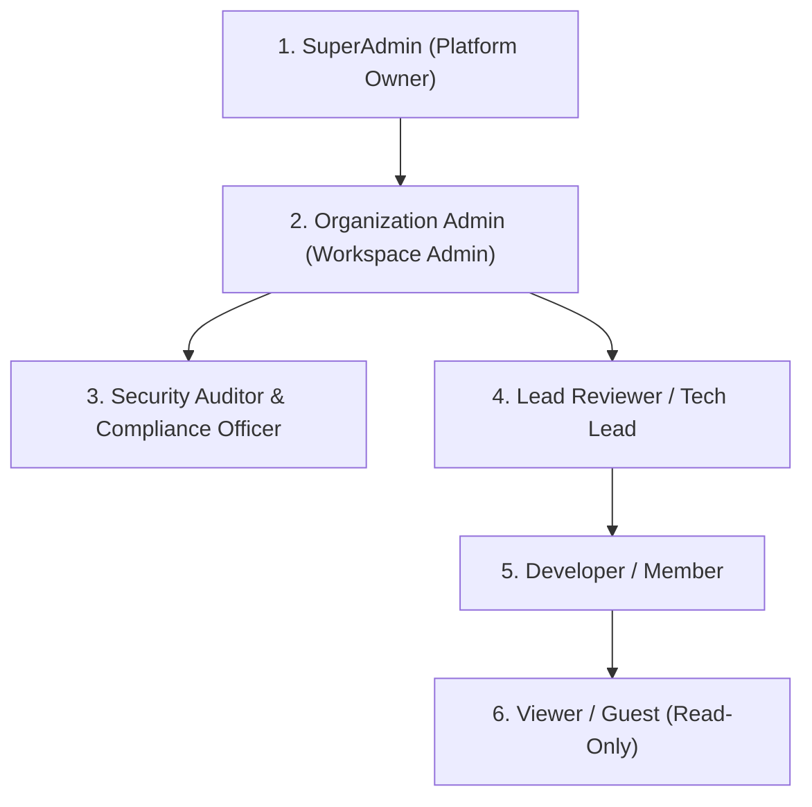
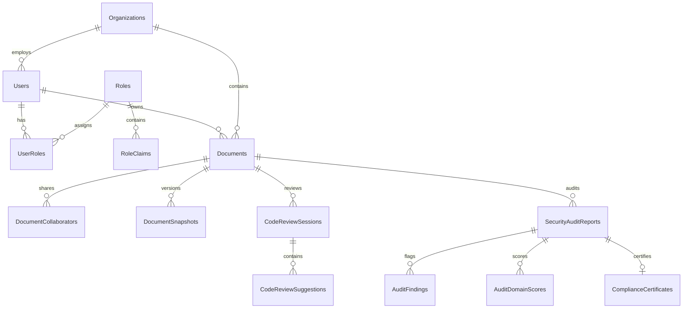
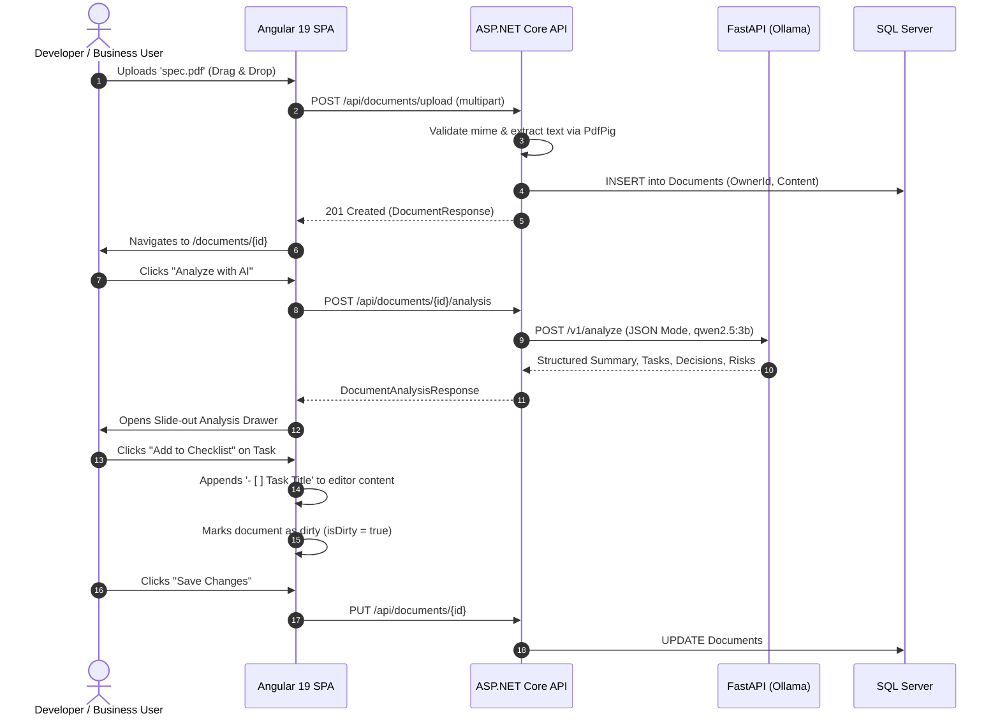
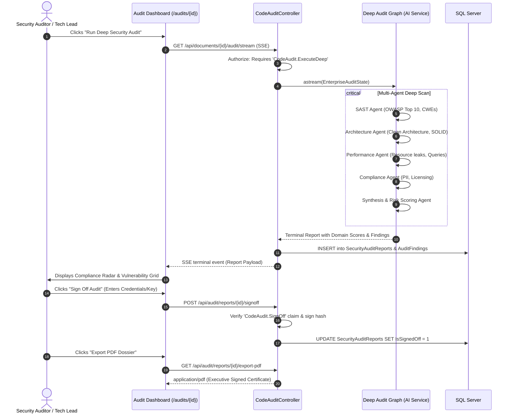

# AIW-Platform: Master Functional, Technical & Architectural Specification (A to Z)

**Document Version:** 2.0.0  
**Status:** Approved Architectural Blueprint  
**Target Platform:** AIW-Platform (Enterprise AI Workspace Platform)  
**Author:** AI Architecture & Core Engineering Team  
**Scope:** Functional & Technical Specifications, Feature Enhancements, Advanced RBAC Architecture, and Decoupled Code Review vs. Code Audit Subsystems  

---

## Table of Contents
1. [Executive Summary & Product Vision](#1-executive-summary--product-vision)
2. [Current System Architecture (As-Is Baseline)](#2-current-system-architecture-as-is-baseline)
   - 2.1 [System Topology & Technology Stack](#21-system-topology--technology-stack)
   - 2.2 [Existing Feature Inventory](#22-existing-feature-inventory)
   - 2.3 [Identified Architectural Gaps & Bottlenecks](#23-identified-architectural-gaps--bottlenecks)
3. [Decoupling Architecture: Code Review vs. Code Audit](#3-decoupling-architecture-code-review-vs-code-audit)
   - 3.1 [Domain Distinction & Core Rationale](#31-domain-distinction--core-rationale)
   - 3.2 [Comparative Matrix: Review vs. Audit](#32-comparative-matrix-review-vs-audit)
   - 3.3 [AI Microservice Decoupling (LangGraph Workflows)](#33-ai-microservice-decoupling-langgraph-workflows)
   - 3.4 [Backend Layer Decoupling (.NET 9 Clean Architecture)](#34-backend-layer-decoupling-net-9-clean-architecture)
   - 3.5 [Frontend Tier Decoupling (Angular 19 Signals & UI)](#35-frontend-tier-decoupling-angular-19-signals--ui)
4. [Enterprise Role-Based Access Control (RBAC) Architecture](#4-enterprise-role-based-access-control-rbac-architecture)
   - 4.1 [Current Shortcomings & Vulnerabilities](#41-current-shortcomings--vulnerabilities)
   - 4.2 [Multi-Tier Role Hierarchy & Tenant Scope](#42-multi-tier-role-hierarchy--tenant-scope)
   - 4.3 [Granular Permissions & Claims Matrix](#43-granular-permissions--claims-matrix)
   - 4.4 [Resource Ownership & Collaboration Access](#44-resource-ownership--collaboration-access)
   - 4.5 [Backend Policy-Based Authorization Engine](#45-backend-policy-based-authorization-engine)
   - 4.6 [Frontend Security Layer (Guards, Signals & Directives)](#46-frontend-security-layer-guards-signals--directives)
5. [Feature Enhancement & Product Improvement Roadmap](#5-feature-enhancement--product-improvement-roadmap)
   - 5.1 [Document Management & Editor Innovations](#51-document-management--editor-innovations)
   - 5.2 [AI Intelligence & Multimodal Ingestion](#52-ai-intelligence--multimodal-ingestion)
   - 5.3 [Operational Telemetry, Governance & Audit Logging](#53-operational-telemetry-governance--audit-logging)
6. [Complete Technical & API Specifications](#6-complete-technical--api-specifications)
   - 6.1 [Database Schemas & Data Model (EF Core 9)](#61-database-schemas--data-model-ef-core-9)
   - 6.2 [RESTful & SSE Streaming API Endpoints](#62-restful--sse-streaming-api-endpoints)
   - 6.3 [LangGraph Multi-Agent State Machine Schemas](#63-langgraph-multi-agent-state-machine-schemas)
7. [End-to-End User Journeys & Functional Workflows](#7-end-to-end-user-journeys--functional-workflows)
   - 7.1 [Document Ingestion, Analysis & Checklist Workflow](#71-document-ingestion-analysis--checklist-workflow)
   - 7.2 [Interactive Developer Code Review Workflow](#72-interactive-developer-code-review-workflow)
   - 7.3 [Enterprise Security & Architecture Audit Workflow](#73-enterprise-security--architecture-audit-workflow)
8. [Phased Implementation & Migration Strategy](#8-phased-implementation--migration-strategy)

---

## 1. Executive Summary & Product Vision

The **AIW-Platform** (AI Workspace Platform) is an enterprise-grade document intelligence and developer productivity ecosystem. It bridges unstructured business document management with intelligent, privacy-first local LLM processing, while providing dedicated multi-agent code intelligence pipelines.

### Primary Objectives of Version 2.0
1. **Separation of Concerns for Code Intelligence**: Cleanly decouple interactive, fast-paced **Code Review** from deep, governance-driven **Code Audit**, creating independent workflows, UI views, data models, and agent topologies.
2. **Enterprise-Grade RBAC & Security**: Replace the rudimentary two-role authentication model with a comprehensive, claim-based Role-Based Access Control (RBAC) and Resource-Based Authorization engine, supporting multi-tenancy, ownership validation, and role hierarchies.
3. **Product & Feature Modernization**: Introduce document versioning, optical character recognition (OCR), asynchronous job orchestration, and rich Monaco-based diff reviews.

---

## 2. Current System Architecture (As-Is Baseline)

### 2.1 System Topology & Technology Stack

The existing implementation operates across three distributed tiers:

```mermaid
graph TD
    subgraph Client ["Client Tier (Port 4200)"]
        UI["Angular 19 SPA<br/>Standalone Components, Signals, SCSS"]
        Proxy["Angular Proxy<br/>proxy.conf.json"]
        UI -->|/api/*| Proxy
    end

    subgraph Backend ["Application Tier (Port 5200)"]
        API["ASP.NET Core 9 Web API<br/>Controllers, Scalar UI, JWT Auth"]
        App["AIW.Application<br/>Commands, DTOs, Extractor"]
        Domain["AIW.Domain<br/>Document, DocumentReviewReport"]
        Infra["AIW.Infrastructure<br/>EF Core 9, IdentityDbContext"]

        Proxy -->|HTTP /api/*| API
        API --> App
        App --> Domain
        Infra --> App
        Infra --> Domain
        App -->|Typed HttpClient| AiClient["IAiServiceClient / IAgentReviewClient"]
    end

    subgraph Persistence ["Persistence Tier (Port 1433)"]
        DB[("Microsoft SQL Server<br/>AIW_Db Database")]
        Infra -->|EF Core 9 Migrations| DB
    end

    subgraph AI_Tier ["AI Inference Tier (Port 8000 & 11434)"]
        FastAPI["FastAPI Microservice<br/>Pydantic v2, SSE Starlette"]
        LangGraph["LangGraph StateGraph<br/>ReviewGraphBuilder"]
        Ollama["Ollama Local Daemon<br/>qwen2.5:3b Model"]

        AiClient -->|POST /v1/analyze| FastAPI
        AiClient -->|POST /v1/review/stream (SSE)| FastAPI
        FastAPI --> LangGraph
        FastAPI -->|HTTP /api/generate| Ollama
        LangGraph -->|LLM Prompts| Ollama
    end
```

### 2.2 Existing Feature Inventory

| Area | Current Implementation Details |
| :--- | :--- |
| **Document Ingestion** | Upload `.pdf` and `.txt` up to 10 MB. PDF text extracted via `PdfPig` (`UglyToad.PdfPig`). Raw text extracted via UTF-8 streams. Stored in `Documents` table. |
| **Document Editing** | Angular 19 editor with reactive signals (`initialContent`, `isDirty`), word/character metrics, and manual/auto-saving. |
| **AI Document Intelligence** | Single-shot extraction via FastAPI (`POST /v1/analyze`) and Ollama (`qwen2.5:3b`). Extracts Executive Summary, Key Takeaways, Candidate Tasks, Decisions, and Risks. |
| **Task to Checklist** | One-click candidate task acceptance that appends markdown checkboxes (`- [ ] Task Title`) directly into the document editor content. |
| **Combined Review / Audit** | Single LangGraph workflow (`ReviewGraphBuilder`) with 5 nodes (`supervisor`, `security_node`, `performance_node`, `architecture_node`, `synthesis_node`). Streamed over Server-Sent Events (SSE) to `<app-review-dashboard>`. Patches applied blindly via string replacement. |
| **Authentication & Auth** | ASP.NET Identity with JWT bearer tokens. Only two hardcoded roles: `Admin` and `Member`. Users freely select their role upon registration. Only `DELETE /api/documents/{id}` checks `[Authorize(Roles = "Admin")]`. No document ownership validation. |

### 2.3 Identified Architectural Gaps & Bottlenecks

1. **Coupled Review and Audit Workflows**:
   - The UI labels the panel "Architecture & Code Audit", while the button reads "Audit & Review".
   - Fast developer feedback (syntax, formatting, diff patching) is forced to wait for deep security static analysis and synthesis scoring.
   - A single database entity (`DocumentReviewReport`) stores both high-level summaries and individual findings without distinguishing between an informal peer code review and a formal security audit.
2. **Insecure & Primitive RBAC**:
   - `RegisterRequest` accepts an arbitrary `role` string, allowing any user to register as `Admin`.
   - Any authenticated user can read (`GET /api/documents/{id}`), modify (`PUT /api/documents/{id}`), or run AI analysis on documents belonging to other users.
   - No fine-grained permissions (e.g., who is authorized to trigger heavy GPU audit runs versus who can merely view findings).
3. **No Monitored Audit Trails or Compliance Artifacts**:
   - Audits do not generate signed certificates, compliance hashes, or downloadable PDF/JSON compliance dossiers.
4. **Resiliency & Scalability Limits**:
   - Long-running reviews and audits run synchronously within HTTP connections without background job queueing or checkpointing.
   - Ollama `qwen2.5:3b` lacks structured fallbacks to larger local models (e.g., `qwen2.5:14b`, `deepseek-coder:6.7b`) or cloud LLM gateways for heavy enterprise audits.

---

## 3. Decoupling Architecture: Code Review vs. Code Audit

### 3.1 Domain Distinction & Core Rationale

In enterprise software engineering, **Code Review** and **Code Audit** address completely distinct business needs, target different stakeholders, require different execution times, and demand different AI agent strategies:

- **Code Review (Developer-Centric)**:
  - *Goal*: Fast, iterative, ergonomic feedback for developers authoring or refactoring code.
  - *Focus*: Clean code, naming conventions, language idioms, test coverage suggestions, line-by-line diffs, and instant patch previews.
  - *Latency SLA*: **< 5 to 10 seconds**.
  - *Lifecycle*: Frequent, informal, ephemeral, triggered per file modification or pull request commit.
- **Code Audit (Governance & Security-Centric)**:
  - *Goal*: Comprehensive, rigorous, and verifiable security, architectural, and regulatory compliance inspection.
  - *Focus*: OWASP Top 10, CWE/CVE vulnerability scanning, taint analysis, secret detection, architecture constraint verification (Domain boundaries, anti-corruption layers, cyclical dependencies), licensing risks, and formal compliance scoring (SOC2 / HIPAA / ISO27001 readiness).
  - *Latency SLA*: **30 seconds to several minutes** (deep multi-agent orchestration or background batch).
  - *Lifecycle*: Periodic, gatekeeping, formal, requiring sign-offs, immutable audit trails, and exportable PDF certification.

### 3.2 Comparative Matrix: Review vs. Audit

| Dimension | Code Review Subsystem | Code Audit Subsystem |
| :--- | :--- | :--- |
| **Primary Persona** | Software Engineer, Peer Reviewer | Tech Lead, Enterprise Architect, CISO, Compliance Officer |
| **Execution Trigger** | Manual button in editor, PR webhook, file save | Release gate, nightly scan, formal compliance milestone |
| **Agent Topology** | Lightweight parallel agents (Syntax, Style, Refactor, Tests) | Deep specialized agents (SAST, Arch Standards, Performance, Policy, Synthesis) |
| **Target Code Scope** | Single file, active snippet, or PR git diff | Whole document, multi-file module, repository package |
| **Output Artifact** | Interactive diff patch, inline suggestions, code score | Executive vulnerability matrix, compliance scores, audit certificate |
| **Application Action** | Apply patch into working editor with one click | Download formal PDF/JSON report, file JIRA/GitHub issues, sign off |
| **Persistence Entity** | `CodeReviewSession`, `CodeReviewComment` | `SecurityAuditReport`, `AuditFinding`, `ComplianceSignoff` |
| **Required Permissions** | `CodeReview.Execute`, `CodeReview.ApplyPatch` | `CodeAudit.ExecuteDeep`, `CodeAudit.ExportReport`, `CodeAudit.SignOff` |

### 3.3 AI Microservice Decoupling (LangGraph Workflows)

We split the single `ReviewGraphBuilder` into two specialized, independently versioned StateGraphs:

```mermaid
graph TB
    subgraph Review_Graph ["1. Developer Code Review Graph (Lightweight & Fast)"]
        R_Start((Start)) --> R_Router[Review Supervisor Router]
        R_Router --> R_Style[Code Style & Idioms Agent]
        R_Router --> R_Refactor[Refactoring & Clean Code Agent]
        R_Router --> R_Test[Unit Test Suggestion Agent]
        R_Style --> R_Diff[Diff & Patch Generator Node]
        R_Refactor --> R_Diff
        R_Test --> R_Diff
        R_Diff --> R_End((End / Stream Output))
    end

    subgraph Audit_Graph ["2. Enterprise Code Audit Graph (Deep & Rigorous)"]
        A_Start((Start)) --> A_Super[Audit Orchestrator & Language Parser]
        A_Super --> A_SAST[SAST & Vulnerability Agent<br/>(OWASP, CWE, Secrets)]
        A_Super --> A_Arch[Architectural Governance Agent<br/>(Clean Arch, SOLID, DDD)]
        A_Super --> A_Perf[Performance & Resource Leak Agent<br/>(Allocations, Streams, DB Queries)]
        A_Super --> A_Compliance[Regulatory & License Policy Agent<br/>(SOC2, PII, Open Source)]
        A_SAST --> A_Synth[Audit Synthesis & Risk Scoring Agent]
        A_Arch --> A_Synth
        A_Perf --> A_Synth
        A_Compliance --> A_Synth
        A_Synth --> A_Cert[Audit Certification & Summary Generator]
        A_Cert --> A_End((End / Persist Report))
    end
```

#### Code Review Graph State & Node Details
- **State (`ReviewState`)**:
  - `document_id`: Guid string
  - `source_code`: Working content
  - `detected_language`: e.g., C#, TypeScript, Python
  - `review_comments`: List of line-specific suggestions
  - `suggested_patches`: List of unified diffs (`old_snippet`, `new_snippet`, `diff_unified`)
  - `readability_score`: 0-100
- **Speed Optimization**: Prompts are compact, temperature is set to `0.1`, utilizing smaller models or targeted prompt templates for sub-second agent responses.

#### Code Audit Graph State & Node Details
- **State (`AuditState`)**:
  - `document_id`: Guid string
  - `audit_session_id`: Unique audit execution ID
  - `source_code` & `filename`
  - `compliance_frameworks`: List of targets (`["OWASP-Top10", "CleanArchitecture", "PCI-DSS"]`)
  - `vulnerabilities`: Aggregated findings with CVSS scores, CWE IDs, and remediation instructions
  - `architectural_violations`: Layering breaches, tight coupling, blocking calls
  - `domain_scores`: Specific scorecards for Security, Performance, Architecture, and Compliance
  - `overall_compliance_score`: 0-100 calculated via weighted penalty algorithm
  - `certification_hash`: SHA-256 hash verifying the audit payload

### 3.4 Backend Layer Decoupling (.NET 9 Clean Architecture)

The backend separates controllers, service abstractions, and domain entities:

```plaintext
backend/src/
├── AIW.Domain/
│   ├── Entities/
│   │   ├── Document.cs                     # Core document entity with OwnerId & OrganizationId
│   │   ├── CodeReview/                     # NEW: Code Review Domain Aggregate
│   │   │   ├── CodeReviewSession.cs
│   │   │   └── CodeReviewSuggestion.cs
│   │   └── CodeAudit/                      # NEW: Code Audit Domain Aggregate
│   │       ├── SecurityAuditReport.cs
│   │       ├── AuditFinding.cs
│   │       ├── AuditDomainScore.cs
│   │       └── AuditComplianceCertificate.cs
│
├── AIW.Application/
│   ├── CodeReview/
│   │   ├── Commands/                       # ExecuteReviewCommand, ApplyPatchCommand
│   │   ├── DTOs/                           # ReviewStreamEvent, PatchPreviewDto
│   │   └── Interfaces/                     # ICodeReviewClient, ICodeReviewService
│   └── CodeAudit/
│   │   ├── Commands/                       # TriggerDeepAuditCommand, ExportAuditPdfCommand
│   │   ├── DTOs/                           # AuditStreamEvent, FullAuditReportDto, SignoffRequest
│   │   └── Interfaces/                     # ICodeAuditClient, ICodeAuditService, IPdfReportGenerator
│
├── AIW.Infrastructure/
│   ├── Persistence/
│   │   ├── Configurations/                 # Separate EF Core table mappings
│   │   │   ├── CodeReviewSessionConfiguration.cs
│   │   │   └── SecurityAuditReportConfiguration.cs
│   │   └── Migrations/
│   └── Services/
│       ├── CodeReviewClient.cs             # Connects to /v1/code-review/stream
│       ├── CodeAuditClient.cs              # Connects to /v1/code-audit/stream
│       └── PdfReportGenerator.cs           # Generates enterprise audit PDF dossiers
│
└── AIW.Api/
    └── Controllers/
        ├── CodeReviewController.cs         # /api/documents/{id}/review (Stream & Patch)
        └── CodeAuditController.cs          # /api/documents/{id}/audit (Deep scan & Reports)
```

### 3.5 Frontend Tier Decoupling (Angular 19 Signals & UI)

The frontend cleanly divides the two features in `frontend/src/app/features/`:

1. **`features/code-review/` (Developer Review Drawer)**:
   - **Trigger**: Click `Quick Code Review` in the document editor toolbar.
   - **UI Component**: `CodeReviewDrawerComponent` sliding out from the right side.
   - **Features**:
     - Fast progress indicator (Style, Refactor, Tests).
     - Inline diff view highlighting changes (green for added, red for deleted).
     - "Apply Patch" button with before/after preview.
     - "Insert Unit Test" button that appends test skeletons into a companion test file.
2. **`features/code-audit/` (Enterprise Audit Suite)**:
   - **Trigger**: Click `Run Deep Security Audit` in the document editor, or navigate to `/audits/:documentId`.
   - **UI Component**: Full-screen or modal dashboard `CodeAuditDashboardComponent`.
   - **Features**:
     - Multi-Agent Stepper with detailed node execution metrics.
     - Compliance radar chart (Security, Architecture, Performance, Maintainability).
     - Severity filters (`Critical`, `High`, `Medium`, `Low`, `Informational`).
     - CWE / OWASP classification tags with external documentation links.
     - "Export Audit PDF" button generating a signed executive summary.
     - "Sign Off Audit" modal requiring an authorized role (`SecurityAuditor`).

---

## 4. Enterprise Role-Based Access Control (RBAC) Architecture

### 4.1 Current Shortcomings & Vulnerabilities

1. **Role Spoofing on Sign-Up**: The registration endpoint accepts any role parameter:
   ```csharp
   // Existing Vulnerability in IdentityService.cs
   var targetRole = string.Equals(request.Role, "Admin", StringComparison.OrdinalIgnoreCase) ? "Admin" : "Member";
   ```
2. **Missing Ownership Boundaries**: The document service retrieves documents without checking user identity:
   ```csharp
   // Existing Vulnerability in DocumentService.cs
   public async Task<DocumentResponse?> GetByIdAsync(Guid id, CancellationToken ct) =>
       await _context.Documents.FindAsync(new object[] { id }, ct); // No UserId filter!
   ```
3. **Coarse-Grained Authorization**: No distinction between operational roles (e.g., developers needing code reviews vs. security officers executing binding audits).

### 4.2 Multi-Tier Role Hierarchy & Tenant Scope

AIW-Platform introduces a 6-tier hierarchical role structure:



1. **`SuperAdmin`**: System-wide configuration, LLM provider switching, global organization onboarding, complete platform telemetry.
2. **`OrganizationAdmin`**: Manages workspace users, role assignments, document sharing policies, audit retention rules.
3. **`SecurityAuditor`**: Authorized to trigger deep compliance audits, view cross-workspace vulnerability trends, sign off on production security audits, and export audit certificates.
4. **`LeadReviewer`**: Manages code review rules, approves code reviews, overrides patch restrictions, views team analytics.
5. **`Developer` (`Member`)**: Drafts, edits, and uploads documents; runs developer code reviews; applies patches to owned documents; views non-sensitive audit reports.
6. **`Viewer` (`Guest`)**: Read-only access to explicitly shared documents and read-only audit summaries. Cannot run AI analysis, review, or audit flows.

### 4.3 Granular Permissions & Claims Matrix

Permissions are represented as discrete string claims in the JWT token following the format `<Domain>.<Action>`:

| Permission Claim | SuperAdmin | OrgAdmin | SecurityAuditor | LeadReviewer | Developer | Viewer |
| :--- | :---: | :---: | :---: | :---: | :---: | :---: |
| `Documents.Create` | ✅ | ✅ | ❌ | ✅ | ✅ | ❌ |
| `Documents.Read` | ✅ | ✅ | ✅ | ✅ | ✅ | ✅ (Shared) |
| `Documents.Update` | ✅ | ✅ | ❌ | ✅ | ✅ (Own) | ❌ |
| `Documents.Delete` | ✅ | ✅ | ❌ | ❌ | ❌ | ❌ |
| `Documents.Share` | ✅ | ✅ | ❌ | ✅ | ✅ (Own) | ❌ |
| `Analysis.Document` | ✅ | ✅ | ✅ | ✅ | ✅ | ❌ |
| `CodeReview.Execute` | ✅ | ✅ | ❌ | ✅ | ✅ | ❌ |
| `CodeReview.ApplyPatch`| ✅ | ✅ | ❌ | ✅ | ✅ (Own) | ❌ |
| `CodeAudit.ExecuteDeep`| ✅ | ✅ | ✅ | ✅ | ❌ | ❌ |
| `CodeAudit.ViewReports`| ✅ | ✅ | ✅ | ✅ | ✅ | ✅ |
| `CodeAudit.ExportReport`| ✅ | ✅ | ✅ | ✅ | ❌ | ❌ |
| `CodeAudit.SignOff` | ✅ | ❌ | ✅ | ❌ | ❌ | ❌ |
| `Users.Manage` | ✅ | ✅ | ❌ | ❌ | ❌ | ❌ |
| `System.Configure` | ✅ | ❌ | ❌ | ❌ | ❌ | ❌ |

### 4.4 Resource Ownership & Collaboration Access

To support multi-tenancy and secure document collaboration, entities in `AIW.Domain` incorporate tenant and ownership boundaries:

```csharp
public class Document
{
    public Guid Id { get; set; }
    public Guid OrganizationId { get; set; } // Multi-Tenant Partition Key
    public Guid OwnerId { get; set; }        // Creator User ID
    public string Title { get; set; } = string.Empty;
    public string Content { get; set; } = string.Empty;
    public DocumentVisibility Visibility { get; set; } = DocumentVisibility.Private;
    public DateTimeOffset CreatedAt { get; set; }
    public DateTimeOffset UpdatedAt { get; set; }

    public ICollection<DocumentCollaborator> Collaborators { get; set; } = new List<DocumentCollaborator>();
}

public enum DocumentVisibility
{
    Private,       // Visible only to Owner and Workspace Admins
    Organization,  // Visible to all members within OrganizationId
    PublicShared   // Read-only link access
}

public class DocumentCollaborator
{
    public Guid DocumentId { get; set; }
    public Guid UserId { get; set; }
    public DocumentRole AccessLevel { get; set; } // Editor, Reviewer, Viewer
}
```

### 4.5 Backend Policy-Based Authorization Engine

Instead of scattering role checks (`[Authorize(Roles = "Admin")]`), the ASP.NET Core 9 backend implements declarative policies:

```csharp
// Program.cs Authorization Policy Definitions
builder.Services.AddAuthorization(options =>
{
    options.AddPolicy("CanExecuteReview", policy =>
        policy.RequireClaim("Permission", "CodeReview.Execute"));

    options.AddPolicy("CanExecuteDeepAudit", policy =>
        policy.RequireClaim("Permission", "CodeAudit.ExecuteDeep"));

    options.AddPolicy("CanSignOffAudit", policy =>
        policy.RequireClaim("Permission", "CodeAudit.SignOff"));

    options.AddPolicy("DocumentOwnerOrEditor", policy =>
        policy.Requirements.Add(new DocumentAccessRequirement(DocumentAccessType.Edit)));
});
```

#### Resource-Based Authorization Handler
A custom `AuthorizationHandler<DocumentAccessRequirement, Document>` checks:
1. Is the current user a `SuperAdmin` or `OrgAdmin` for that organization? If yes, allow.
2. Is the current user the `OwnerId` of the document? If yes, allow.
3. Is the user explicitly listed in `DocumentCollaborator` with `AccessLevel >= Editor`? If yes, allow.
4. Otherwise, reject with HTTP 403 Forbidden.

### 4.6 Frontend Security Layer (Guards, Signals & Directives)

#### 1. Reactive Angular Auth Store
`AuthService` expands to expose computed permission checks:
```typescript
@Injectable({ providedIn: 'root' })
export class AuthService {
  readonly session = signal<AuthSession | null>(this.loadInitialSession());

  readonly isAuthenticated = computed(() => !!this.session()?.token);
  readonly userRole = computed(() => this.session()?.role ?? 'Viewer');
  readonly permissions = computed(() => new Set(this.session()?.permissions ?? []));

  hasPermission(permission: string): boolean {
    return this.permissions().has(permission);
  }

  hasAnyPermission(perms: string[]): boolean {
    return perms.some(p => this.permissions().has(p));
  }
}
```

#### 2. Angular Structural Permission Directive
Allows UI elements to conditionally render based on RBAC permissions:
```typescript
@Directive({
  selector: '[appHasPermission]',
  standalone: true
})
export class HasPermissionDirective {
  private readonly auth = inject(AuthService);
  private readonly templateRef = inject(TemplateRef);
  private readonly viewContainer = inject(ViewContainerRef);

  @Input() set appHasPermission(permission: string) {
    if (this.auth.hasPermission(permission)) {
      this.viewContainer.createEmbeddedView(this.templateRef);
    } else {
      this.viewContainer.clear();
    }
  }
}
```

*Usage in HTML*:
```html
<!-- Only users with audit permission see the deep audit trigger -->
<button *appHasPermission="'CodeAudit.ExecuteDeep'" (click)="openAuditModal()">
  Run Deep Security Audit
</button>
```

#### 3. Functional Route Guards
Routes are guarded via `permissionGuard`:
```typescript
export const permissionGuard: (permission: string) => CanActivateFn = 
  (permission: string) => () => {
    const auth = inject(AuthService);
    const router = inject(Router);
    if (auth.hasPermission(permission)) {
      return true;
    }
    router.navigate(['/forbidden']);
    return false;
  };
```

---

## 5. Feature Enhancement & Product Improvement Roadmap

### 5.1 Document Management & Editor Innovations

1. **Dual-Pane Monaco Editor & Markdown WYSIWYG**:
   - Replace standard `<textarea>` with Monaco Editor or TipTap rich-text editor.
   - Syntax highlighting for 20+ programming languages when drafting or reviewing source documents.
   - Synchronized side-by-side rendering with GitHub Flavored Markdown preview.
2. **Document Versioning & Revision Diffing**:
   - Save automated snapshot checkpoints whenever AI analysis or code reviews are executed.
   - Visual time-machine slider allowing users to compare revisions and revert regressions.
3. **Batch Document Ingestion**:
   - Multi-file drag-and-drop supporting `.pdf`, `.docx`, `.md`, `.cs`, `.ts`, `.py`, and `.json`.
   - Asynchronous batch parsing displaying individual file extraction progress bars.

### 5.2 AI Intelligence & Multimodal Ingestion

1. **Scanned PDF OCR Pipeline**:
   - Augment `PdfPig` with an OCR worker (Tesseract OCR / PaddleOCR).
   - If `PdfPig` detects 0 characters (scanned or image-only PDF), automatically dispatch to OCR rather than rejecting the file.
2. **Model-Agnostic LLM Gateway**:
   - Implement an extensible LLM provider in `ai-service`:
     - Default: Local Ollama daemon (`qwen2.5:3b`, `deepseek-coder:6.7b`).
     - Enterprise Fallback: Azure OpenAI / Google Gemini API via secure API key configuration in `appsettings.json`.
3. **Retrieval-Augmented Generation (RAG) Document Search**:
   - Embed document paragraphs using `nomic-embed-text` in Ollama.
   - Store embeddings in SQL Server 2025 / Vector Search or pgvector.
   - Enable cross-document semantic query ("Find all architectural decisions regarding authentication made last quarter").

### 5.3 Operational Telemetry, Governance & Audit Logging

1. **Immutable Audit Event Ledger**:
   - Every document creation, edit, code review, patch application, and audit execution is logged to an append-only `AuditLogEvents` table.
   - Tracks `UserId`, `TimestampUtc`, `Action`, `ResourceId`, `IpAddress`, and `HashDigest`.
2. **OpenTelemetry & Structured Logging**:
   - Backend logging configured with Serilog and OpenTelemetry instrumentation.
   - AI microservice LangGraph execution traces logged with step latency metrics (`step_duration_ms`).

---

## 6. Complete Technical & API Specifications

### 6.1 Database Schemas & Data Model (EF Core 9)



#### SQL Server Table Definitions

```sql
-- 1. Organizations (Multi-Tenancy)
CREATE TABLE Organizations (
    Id UNIQUEIDENTIFIER PRIMARY KEY DEFAULT NEWID(),
    Name NVARCHAR(150) NOT NULL,
    Slug NVARCHAR(50) NOT NULL UNIQUE,
    CreatedAtUtc DATETIMEOFFSET NOT NULL DEFAULT SYSDATETIMEOFFSET()
);

-- 2. Extended Documents Table
CREATE TABLE Documents (
    Id UNIQUEIDENTIFIER PRIMARY KEY DEFAULT NEWID(),
    OrganizationId UNIQUEIDENTIFIER NOT NULL,
    OwnerId UNIQUEIDENTIFIER NOT NULL,
    Title NVARCHAR(250) NOT NULL,
    Content NVARCHAR(MAX) NOT NULL,
    Visibility INT NOT NULL DEFAULT 0, -- 0=Private, 1=Org, 2=Public
    CreatedAtUtc DATETIMEOFFSET NOT NULL DEFAULT SYSDATETIMEOFFSET(),
    UpdatedAtUtc DATETIMEOFFSET NOT NULL DEFAULT SYSDATETIMEOFFSET(),
    CONSTRAINT FK_Documents_Organizations FOREIGN KEY (OrganizationId) REFERENCES Organizations(Id),
    CONSTRAINT FK_Documents_Users FOREIGN KEY (OwnerId) REFERENCES Users(Id)
);

-- 3. Code Review Sessions (Developer Review)
CREATE TABLE CodeReviewSessions (
    Id UNIQUEIDENTIFIER PRIMARY KEY DEFAULT NEWID(),
    DocumentId UNIQUEIDENTIFIER NOT NULL,
    InitiatorId UNIQUEIDENTIFIER NOT NULL,
    Status NVARCHAR(30) NOT NULL, -- Completed, InProgress, Failed
    ReadabilityScore INT NOT NULL,
    Summary NVARCHAR(MAX) NOT NULL,
    CreatedAtUtc DATETIMEOFFSET NOT NULL DEFAULT SYSDATETIMEOFFSET(),
    CONSTRAINT FK_CodeReview_Document FOREIGN KEY (DocumentId) REFERENCES Documents(Id) ON DELETE CASCADE
);

CREATE TABLE CodeReviewSuggestions (
    Id UNIQUEIDENTIFIER PRIMARY KEY DEFAULT NEWID(),
    SessionId UNIQUEIDENTIFIER NOT NULL,
    Category NVARCHAR(50) NOT NULL, -- Style, Refactoring, Performance, Tests
    Title NVARCHAR(200) NOT NULL,
    Comment NVARCHAR(MAX) NOT NULL,
    LineStart INT NULL,
    LineEnd INT NULL,
    ProblematicSnippet NVARCHAR(MAX) NOT NULL,
    SuggestedSnippet NVARCHAR(MAX) NOT NULL,
    DiffUnified NVARCHAR(MAX) NOT NULL,
    IsApplied BIT NOT NULL DEFAULT 0,
    AppliedAtUtc DATETIMEOFFSET NULL,
    CONSTRAINT FK_Suggestions_Session FOREIGN KEY (SessionId) REFERENCES CodeReviewSessions(Id) ON DELETE CASCADE
);

-- 4. Security Audit Reports (Formal Audit)
CREATE TABLE SecurityAuditReports (
    Id UNIQUEIDENTIFIER PRIMARY KEY DEFAULT NEWID(),
    DocumentId UNIQUEIDENTIFIER NOT NULL,
    AuditorId UNIQUEIDENTIFIER NOT NULL,
    AuditType NVARCHAR(50) NOT NULL, -- DeepSecurity, ArchGovernance, FullCompliance
    OverallScore INT NOT NULL,
    SecurityScore INT NOT NULL,
    ArchitectureScore INT NOT NULL,
    PerformanceScore INT NOT NULL,
    ComplianceScore INT NOT NULL,
    ExecutiveSummary NVARCHAR(MAX) NOT NULL,
    IsSignedOff BIT NOT NULL DEFAULT 0,
    SignedOffByUserId UNIQUEIDENTIFIER NULL,
    SignedOffAtUtc DATETIMEOFFSET NULL,
    DigitalSignatureHash NVARCHAR(128) NOT NULL,
    CreatedAtUtc DATETIMEOFFSET NOT NULL DEFAULT SYSDATETIMEOFFSET(),
    CONSTRAINT FK_Audit_Document FOREIGN KEY (DocumentId) REFERENCES Documents(Id) ON DELETE CASCADE
);

CREATE TABLE AuditFindings (
    Id UNIQUEIDENTIFIER PRIMARY KEY DEFAULT NEWID(),
    ReportId UNIQUEIDENTIFIER NOT NULL,
    Domain NVARCHAR(50) NOT NULL,    -- Security, Architecture, Performance, Compliance
    Severity NVARCHAR(20) NOT NULL,  -- Critical, High, Medium, Low, Informational
    CweId NVARCHAR(20) NULL,         -- e.g. CWE-89 (SQL Injection)
    OwaspCategory NVARCHAR(50) NULL, -- e.g. A03:2021-Injection
    Title NVARCHAR(250) NOT NULL,
    Description NVARCHAR(MAX) NOT NULL,
    ExploitImpact NVARCHAR(MAX) NOT NULL,
    ProblematicCode NVARCHAR(MAX) NOT NULL,
    RecommendedPatch NVARCHAR(MAX) NOT NULL,
    CreatedAtUtc DATETIMEOFFSET NOT NULL DEFAULT SYSDATETIMEOFFSET(),
    CONSTRAINT FK_AuditFindings_Report FOREIGN KEY (ReportId) REFERENCES SecurityAuditReports(Id) ON DELETE CASCADE
);
```

### 6.2 RESTful & SSE Streaming API Endpoints

#### Authentication & Administration Endpoints

| Method | Endpoint | Authorization | Description |
| :--- | :--- | :--- | :--- |
| `POST` | `/api/auth/register` | Anonymous | Register user (default role: `Viewer` or `Developer`). |
| `POST` | `/api/auth/login` | Anonymous | Authenticate & receive JWT token with claim permissions. |
| `POST` | `/api/auth/refresh` | `[Authorize]` | Exchange refresh token for fresh JWT. |
| `GET` | `/api/users/me` | `[Authorize]` | Retrieve profile, current roles, and permissions. |
| `PUT` | `/api/admin/users/{id}/roles`| `[HasPermission("Users.Manage")]` | Assign or revoke roles to users. |

#### Document Management Endpoints

| Method | Endpoint | Authorization | Description |
| :--- | :--- | :--- | :--- |
| `GET` | `/api/documents` | `[HasPermission("Documents.Read")]` | List accessible documents (filtered by organization and ownership). |
| `GET` | `/api/documents/{id}` | `[HasPermission("Documents.Read")]` | Get single document by ID (verified via ownership/sharing handler). |
| `POST` | `/api/documents` | `[HasPermission("Documents.Create")]` | Create new document. Automatically sets `OwnerId`. |
| `PUT` | `/api/documents/{id}` | `[HasPermission("Documents.Update")]` | Update document. Requires Owner or Editor collaborator role. |
| `DELETE`| `/api/documents/{id}` | `[HasPermission("Documents.Delete")]` | Delete document. Requires Owner or Admin. |
| `POST` | `/api/documents/upload`| `[HasPermission("Documents.Create")]` | Multipart upload `.pdf` / `.txt` with automatic extraction. |
| `POST` | `/api/documents/{id}/analysis` | `[HasPermission("Analysis.Document")]` | Extract summaries, tasks, decisions, and risks via LLM. |

#### Decoupled Code Review Endpoints

| Method | Endpoint | Authorization | Description |
| :--- | :--- | :--- | :--- |
| `GET` | `/api/documents/{id}/review/stream` | `[HasPermission("CodeReview.Execute")]` | SSE stream for real-time developer code review. |
| `GET` | `/api/documents/{id}/review/history`| `[HasPermission("Documents.Read")]` | Retrieve past review sessions and suggestion history. |
| `POST` | `/api/documents/{id}/review/apply-patch` | `[HasPermission("CodeReview.ApplyPatch")]` | Atomically apply unified diff patch to document content. |

#### Decoupled Code Audit Endpoints

| Method | Endpoint | Authorization | Description |
| :--- | :--- | :--- | :--- |
| `GET` | `/api/documents/{id}/audit/stream` | `[HasPermission("CodeAudit.ExecuteDeep")]` | SSE stream for deep multi-agent security audit. |
| `GET` | `/api/documents/{id}/audit/reports` | `[HasPermission("CodeAudit.ViewReports")]` | List historical audit reports with scores and dates. |
| `GET` | `/api/audit/reports/{reportId}` | `[HasPermission("CodeAudit.ViewReports")]` | Retrieve complete audit report details and findings. |
| `POST` | `/api/audit/reports/{reportId}/signoff` | `[HasPermission("CodeAudit.SignOff")]` | Formal security officer sign-off with digital hash. |
| `GET` | `/api/audit/reports/{reportId}/export-pdf`| `[HasPermission("CodeAudit.ExportReport")]` | Download formal PDF audit certification dossier. |

### 6.3 LangGraph Multi-Agent State Machine Schemas

#### 1. Code Review State (`ai-service/app/graph/review_state.py`)
```python
from typing import Annotated, Dict, List, Optional
from typing_extensions import TypedDict
import operator

class ReviewSuggestionItem(TypedDict):
    id: str
    category: str  # "Style" | "Refactoring" | "Test"
    title: str
    comment: str
    line_start: Optional[int]
    line_end: Optional[int]
    problematic_snippet: str
    suggested_snippet: str
    diff_unified: str

class DeveloperReviewState(TypedDict):
    document_id: str
    filename: str
    source_code: str
    detected_language: Optional[str]
    readability_score: Optional[int]
    suggestions: Annotated[List[ReviewSuggestionItem], operator.add]
    current_step: str
    errors: Annotated[List[str], operator.add]
```

#### 2. Code Audit State (`ai-service/app/graph/audit_state.py`)
```python
from typing import Annotated, Dict, List, Optional
from typing_extensions import TypedDict
import operator
from pydantic import BaseModel

class VulnerabilityFinding(BaseModel):
    id: str
    domain: str  # "Security" | "Architecture" | "Performance" | "Compliance"
    severity: str  # "Critical" | "High" | "Medium" | "Low" | "Informational"
    cwe_id: Optional[str]
    owasp_category: Optional[str]
    title: str
    description: str
    exploit_impact: str
    problematic_code: str
    recommended_patch: str

class DomainScorecard(BaseModel):
    domain: str
    score: int
    summary_verdict: str

class EnterpriseAuditState(TypedDict):
    document_id: str
    audit_id: str
    filename: str
    source_code: str
    compliance_frameworks: List[str]
    findings: Annotated[List[VulnerabilityFinding], operator.add]
    domain_scores: Annotated[List[DomainScorecard], operator.add]
    overall_score: Optional[int]
    executive_summary: Optional[str]
    digital_signature_hash: Optional[str]
    current_step: str
    errors: Annotated[List[str], operator.add]
```

---

## 7. End-to-End User Journeys & Functional Workflows

### 7.1 Document Ingestion, Analysis & Checklist Workflow



### 7.2 Interactive Developer Code Review Workflow

```mermaid
sequenceDiagram
    autonumber
    actor Dev as Developer
    participant Angular as Document Editor
    participant RevDrawer as Code Review Drawer
    participant Backend as CodeReviewController
    participant LangGraph as Review StateGraph (AI Service)

    Dev->>Angular: Editing 'OrderService.cs'
    Dev->>Angular: Clicks "Quick Code Review"
    Angular->>RevDrawer: Opens Drawer & calls startReviewStream()
    RevDrawer->>Backend: GET /api/documents/{id}/review/stream (SSE)
    Backend->>LangGraph: astream(DeveloperReviewState)

    par Parallel Review Agents
        LangGraph->>LangGraph: Style & Idioms Agent
        LangGraph->>LangGraph: Refactoring & Clean Code Agent
        LangGraph->>LangGraph: Test Coverage Agent
    end

    LangGraph->>LangGraph: Generate Unified Diffs
    LangGraph-->>Backend: SSE data: { node, suggestions, readability }
    Backend-->>RevDrawer: SSE event stream
    RevDrawer->>Dev: Renders side-by-side diffs & suggestions

    Dev->>RevDrawer: Clicks "Apply Patch" on Suggestion #2
    RevDrawer->>Backend: POST /api/documents/{id}/review/apply-patch
    Backend->>Backend: Verifies Ownership & Applies Unified Diff
    Backend-->>Angular: Updated document content
    Angular->>Dev: Updates Editor view; marks patch as applied
```

### 7.3 Enterprise Security & Architecture Audit Workflow



---

## 8. Phased Implementation & Migration Strategy

To execute this architecture seamlessly without downtime or disruptive rewrites, the development plan is sequenced into five distinct engineering phases:

### Phase 1: Database Migration & Core RBAC Foundation
1. **Extend Domain Entities**:
   - Add `OrganizationId`, `OwnerId`, `Visibility`, and `DocumentCollaborator` to `Document.cs`.
   - Create EF Core configurations for `Organizations`, `CodeReviewSessions`, `CodeReviewSuggestions`, `SecurityAuditReports`, and `AuditFindings`.
2. **Execute EF Core Migrations**:
   - Generate migration `AddDecoupledReviewAuditAndRbacEntities`.
   - Seed default system permissions and assign roles (`SuperAdmin`, `OrgAdmin`, `SecurityAuditor`, `LeadReviewer`, `Developer`, `Viewer`).
3. **Secure Auth Endpoints**:
   - Update `AuthController.Register` to eliminate arbitrary role assignment; default new users to `Developer` or `Viewer`.
   - Configure ASP.NET Core Policy-based authorization handlers for document ownership checks.

### Phase 2: AI Microservice Decoupling (LangGraph)
1. **Split State & Models**:
   - Create `app/graph/review_workflow.py` with fast, lightweight nodes for style, refactoring, and test suggestions.
   - Create `app/graph/audit_workflow.py` with deep agents for SAST, Architecture, Performance, and Compliance scoring.
2. **Create Independent FastAPI Routes**:
   - Expose `POST /v1/code-review/stream` for developer reviews.
   - Expose `POST /v1/code-audit/stream` for formal security audits.
   - Maintain legacy `/v1/review/stream` as a deprecated backward-compatible proxy during migration.

### Phase 3: Backend API & Service Layer Separation
1. **Implement Application Services**:
   - Develop `CodeReviewService` and `CodeAuditService` implementing distinct interfaces.
   - Integrate `DiffPlex` or unified diff patching library for atomic patch application in `CodeReviewService`.
   - Implement `PdfReportGenerator` (using QuestPDF or iText) to assemble formal audit PDF dossiers.
2. **Deploy Specialized Controllers**:
   - Create `CodeReviewController.cs` with `[HasPermission("CodeReview.Execute")]`.
   - Create `CodeAuditController.cs` with `[HasPermission("CodeAudit.ExecuteDeep")]`.

### Phase 4: Frontend UI Restructuring & Monaco Integration
1. **Refactor Feature Folders**:
   - Create `features/code-review` containing `CodeReviewDrawerComponent` and `ReviewService`.
   - Create `features/code-audit` containing `CodeAuditDashboardComponent`, `AuditReportComponent`, and `AuditService`.
2. **Implement Security Directives**:
   - Add `*appHasPermission` directive and `permissionGuard` across Angular routes.
   - Update `DocumentEditorComponent` toolbar:
     - Replace single "Audit & Review" button with two distinct actions:
       - ⚡ **"Code Review"** (Drawer with interactive diffs)
       - 🛡️ **"Security Audit"** (Formal compliance view with exportable certificate)

### Phase 5: Testing, Hardening & Verification
1. **Automated Unit & Integration Test Suites**:
   - Backend: Unit tests for `DocumentAccessHandler`, `CodeReviewService`, and `CodeAuditService`.
   - AI Service: E2E tests validating token generation, JSON parsing, and LangGraph fallback handlers.
   - Frontend: Vitest unit tests verifying signal calculations, permission directive rendering, and SSE stream handling.
2. **Penetration & RBAC Verification**:
   - Verify that non-admin and non-owner users receive HTTP 403 when attempting unauthorized document access, review execution, or audit sign-offs.

---

## 9. Appendix: Document Conventions & Architecture Principles

- **Zero-Trust AI Sandbox**: No proprietary document content or source code ever leaves the local enterprise deployment perimeter. All AI inference is strictly routed to the internal Ollama instance.
- **Clean Architecture Boundaries**: Domain entities remain pure and devoid of external framework references. Application use cases coordinate workflows. Infrastructure encapsulates EF Core and HTTP clients.
- **Signal-First Angular Reactivity**: Avoid manual RxJS subscriptions where Angular Signals (`signal`, `computed`, `input`, `output`) provide declarative, zoneless-ready change detection.
- **Immutable Audit Trails**: Once an audit report is signed off by an authorized Security Auditor, its findings and scores become immutable; any subsequent code modification requires generating a new audit session ID.

